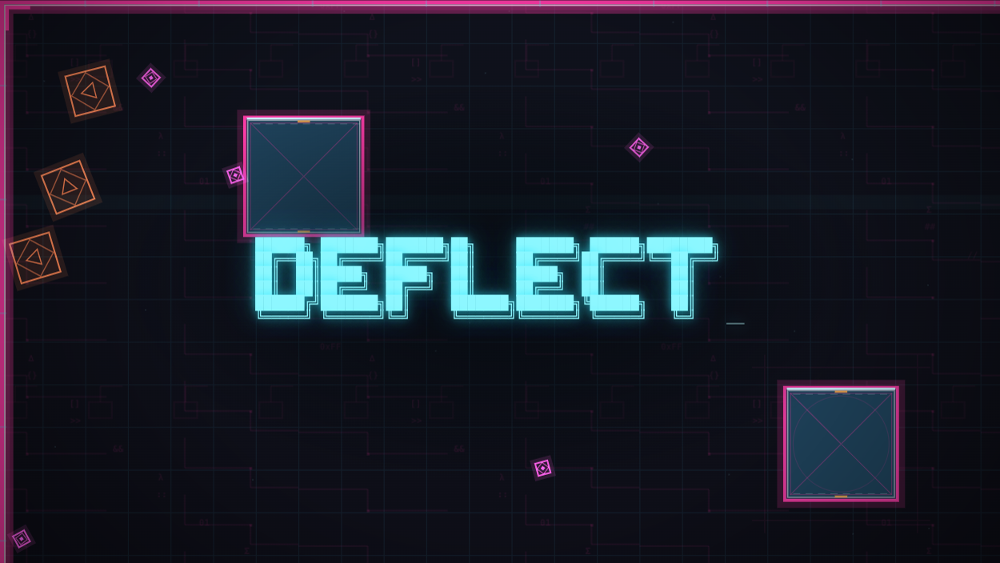

# DEFLECT

**Play the current alpha:** <https://spuds0588.github.io/DEFLECT/>

**Kiosk demo:** [launch the unattended demo](https://spuds0588.github.io/DEFLECT/?demo=true) — the
`DEFLECT_` wordmark over a live bot-run gauntlet, fading away and returning on a 60-second loop. Runs
rotate between one, two and three local pilots; the three-player runs stay on compact arenas so the whole
fight remains one shared view. No input, no menus, no exit; leave it by closing the tab. For a display or
capture, this is the URL to use.

[](https://spuds0588.github.io/DEFLECT/?demo=true)

DEFLECT is an ultra-responsive, top-down geometric duelist game built for the web. It merges the
accelerating volley tension of Lethal League with twitch-reflex arena combat. Everything in the arena is
drawn from simple neon shapes and every sound is synthesized in the browser — no spritesheet or audio
assets, only generated PWA icons. The soundtrack is an 82 BPM lofi-house loop built from MIDI note
numbers, with a vinyl-crackle bed.

**Playable now:** solo training against a sparring drone or endless 1v1–1v3 bot practice, **VS BOTS**
round matches against one to three local opponents, a scored local **GAUNTLET** against worms, viruses,
cascading errors, shooters and infected thralls, the first **CAMPAIGN** node, or host/join a room for up
to 8 players. Nine arenas are selectable from the title screen, including the multi-district
`MAINFRAME`, the multi-deck `TRANSIT`, the wall-less `THE LEDGE`, the compaction-plate `RECYCLING BIN`
and the spinning, hole-riddled `DISK PLATTER`. Match modes are first to 3 rounds; training is continuous practice, while gauntlet is a
one-life score chase with a local top-runs table.

**Campaign (story mode):** `SINGLE PLAYER > CAMPAIGN` opens three local save slots first. An empty slot
starts a new run: pick the bot count (none to three), then your program. A filled slot shows the level
and player count and resumes the run, skipping both steps. Bots take the programs you leave unused. The
first node, `BUILD ROOT`, opens with a calibration prologue: six dormant shapes wake, open a red eye and
demonstrate one attack family each: a bouncing blue circle, a floating red mother with a shard cloud, and
a yellow row of clones that charges together. Clear all six, then spar against the bot squad (a `NO BOTS` run
still drills against one instructor), survive a `SYSTEM BREACH` warning, then face a live threat assault:
delete 10 threats to
clear it. The clear reports kills, time, damage taken, data crates preserved and a score; losing no crates
is a clean sweep and pays a bonus, and the best score and sweep count stay in the slot. Clearing writes the
slot and returns to the save list; a run is never saved mid-level. Only one node is authored, so a cleared
slot replays it for now. The layout brief and handoff checklist live in [CAMPAIGN.md](CAMPAIGN.md).

**Multiplayer menu:** `MULTIPLAYER` offers `ONLINE` (host a room or join by code) and `LOCAL` (same-screen
play, not built yet). Local lists its two modes, `ARENA` and `GAUNTLET`, as placeholders until the setup
screen exists. Public room discovery is planned: it will search for game codes with a shared prefix,
while private rooms keep an unprefixed code.

## Play

The latest main-branch build is deployed to GitHub Pages:

<https://spuds0588.github.io/DEFLECT/>

Run it locally:

```bash
npm install
npm run dev
```

Open <http://127.0.0.1:5173>. Create a room and share the invite link / 4-character code; guests can
join from another tab, browser, or machine that can reach the app.

Production build and local preview:

```bash
npm run build
npm run preview
```

The build is a static PWA in `dist/`; serve it over HTTPS to install it and to use the offline shell.

## Controls

Gamepad, keyboard/mouse and touch are supported. The most recently used device takes over; there is no
on-screen input-mode badge. A phone or tablet gets the touch layout automatically, and `?touch=1` /
`?touch=0` forces it on or off for testing.

For unattended testing, add `?autoplay=2` to the local URL. Bots drive every slot, including the local
one, and the match auto-rematches so it keeps running without input. This is a QA hook, not a menu mode.

More QA hooks exist: `?split=N` lays out up to four local panes, `?gauntlet=1&arena=5&bot=1` boots a
gauntlet with a bot driving the local player, `?attract=1` boots the title demo immediately, `?demo=true`
runs that demo as a permanent, non-interactive display loop, `?ui=0` hides the canvas UI for one load,
`?touch=1` forces the phone layout and `?debug=1` exposes a read-only inspection handle. None of them
appear in a menu or a snapshot.

Leave the title alone for 24 seconds and it starts an attract demo: a random program in a random arena,
fighting a deep gauntlet wave with the canvas UI off. Any key, click, wheel or pad press brings the title
back. If the pilot dies, the arena keeps simulating the death aftermath for four seconds before the next
random run starts; it does not hold the last frame. For a showfloor or a capture, add `?demo=true`: the same run, but input cannot leave it and the
centered `DEFLECT_` wordmark fades in, clears the screen, and returns on a 60-second cycle; the next run
alternates from one to two to three local pilots. `GAME UI` in Settings > Feedback
hides the whole canvas UI layer for a clean capture. On a gamepad, `View` / `Select` toggles that layer
for the current session without rewriting the saved choice; `Start` remains the in-game menu button.

The camera frames the local group. With several local players it stays on one screen and pulls back until
the group no longer fits, then splits into the fewest panes: one far player adds one pane, not three. Each
pane has a colored frame, the shared minimap moves to the top centre, and the sim briefly slows on a
split or merge so nobody is shot while their screen is moving.

| Action | Gamepad | Keyboard/mouse |
| --- | --- | --- |
| Move + face | Left stick | `WASD` / arrows |
| Melee attack / guard | `B` | Left mouse / `J` |
| Ranged attack | `X` | Right mouse / `K` |
| Power attack (hold) / skill (tap) | `Y` | `E` or `L` / middle mouse |
| Lock target | `LT` | `Q` |
| Cycle lock target (hold `LT`) | `RB` / right stick left-right | — |
| Dash / charged dash | `A` or `L3` | `Shift` / `Space` |
| Confirm / menu | `A` / `Start`, D-pad | `Enter`, arrows, focused button + `Space` |
| In-game menu | `Start` | `Escape` |
| Hide/show UI | `View` / `Select` | — |
| Mute | — | `M` |
| Perf HUD | — | `F3` |

There is no aim stick. **Movement is facing.** Melee attacks lock the direction you commit to. Dashing
commits to the **last movement direction**, even while target lock is holding your facing, so strafing
past an enemy and dashing goes sideways. Standing still keeps your last facing.

**Touch layout:** a stick at the bottom left and `SHIELD`, `SKILL` and `DASH` buttons at the bottom
right. The stick sets facing by movement, exactly like a pad: it is not a second aim stick. Tap `SHIELD`
for the lash and hold it for guard/reflect. Tap `SKILL` for the program skill and hold it for the power
attack. Tap `DASH` to dodge and hold for the charged dash. `AUTO LOCK` and `AUTO ATTACK` default on for
touch and live in `SETTINGS > CONTROLS`: auto lock holds the nearest visible target, and auto attack
fires the ranged attack on that target, switching to melee inside reach. Both can be turned off; with
both off the touch layout has no manual ranged button. The touch layout hides the minimap and puts the
readiness dock at the top centre. `GAME UI` hides the canvas readout but leaves the stick and buttons, since
those are the phone's controls.

The title is a console menu: arrows or the left stick move the `>` cursor, Enter or `A` confirms, and
Escape or `B` backs out. `HOW TO PLAY` holds the control tables and a short rules and program rundown;
it shows a gamepad, touch or keyboard/mouse layout based on the input device. `SETTINGS` is the fourth
option. `SETTINGS > FEEDBACK` holds hit rotation, impact flash, scanlines, minimap, game UI, rumble and
the hit-preview test; `SETTINGS > AUDIO` holds the volume controls; `SETTINGS > SYSTEM` holds the callsign
and reset; `SETTINGS > CONTROLS` holds auto lock and auto attack.

Controller rumble is on by default and can be switched off in `SETTINGS > FEEDBACK`. It uses the standard
Gamepad `vibrationActuator` where the browser exposes it and falls back to the older `hapticActuators`
pulse surface; a pad without either stays silent. Cues are short: a tap for a swing or dash, a light tick
for a caught shot, a thump for a spent health segment, a boom for a nearby explosion, and a longer death
thump.

## Attacks, skill, and health

Your avatar has its health segments built into its rotating program outline: three for most programs,
**six** for Atomize and Compress. A hit drops that segment to a dim ghost, so the silhouette always stays whole while
the damage still reads at a glance. There is no separate health bar or name plate: the outline, the inner
energy arc, and the readiness dock are the local readout. Bots and remote players show no health or
readiness telemetry yet.

| Option | Input | Role |
| --- | --- | --- |
| **RANGED ATTACK** | `X` / right mouse / `K` | Your program's basic fire. Probe sends a five-shot stream, Wedge a three-shot string, Fisher a piercing spear, Sweep throws a dust-trailing broom that shoves on contact, Toxic fires a venom needle, Kaboom lobs a slow bomb, Bad Lag throws a heavy hourglass, Atomize fires an alternating electron that curves toward a target, and Ghost throws a wide chomping mouth that hits for two and dazes, and Compress fires a slow pressure orb that shrinks the victim and permanently lowers their health cap. Holding keeps the fire coming at the program's cadence. |
| **MELEE ATTACK** | `B` / left mouse / `J` | **Tap** for a fast spiked lash across the 180° arc in front of you. It shoves what it hits sideways and reflects shots it catches. |
| **GUARD** | Hold `B` / left mouse / `J` | A 180° shield that reflects every shot in front for up to 1 s. Every caught shot burns shield time; a broken guard enters a 0.28 s cooldown. Lock on to flatten caught shots toward the target. |
| **POWER ATTACK** | Hold `Y` / `E` / `L` / middle mouse | The program's heavy. Probe charges a piercing beam, Wedge plows forward with a bracket, Fisher draws a freeform web behind himself that reflects shots and holds anything that touches it until it fades, Sweep builds a giant broom and sweeps it across the room, Kaboom throws a row of bombs, Bad Lag dilates time, Atomize opens an orbit field that captures shots and small enemies and flings them outward, and Ghost arms a jump-scare that fires on any action press (or expires) for a burst that damages everything in the ring and throws every body in it clear, and Compress fires a pressure burst that halves the size and health cap of everything in the ring, crushing anything on its last point. Most heavies commit you: you cannot move freely while they run. Atomize's field lets you walk. Every heavy has a long cooldown. |
| **SKILL** | Tap `Y` / `E` / `L` / middle mouse | The program's assigned skill. Probe plants a proximity mine, Wedge plants a solid bracket wall behind himself, Fisher drops a lure beacon, Sweep splits two brooms outward to clear a lane, Kaboom lobs a heavy shell, Bad Lag fast-forwards, Atomize raises three orbiting shield balls, Ghost cloaks for a few seconds, and Compress folds small and runs fast for 3.5 seconds. Its mark in the readiness dock shows when it is ready. |
| **DASH** | `A` / `Shift` / `Space` | Two charges. Tap to phase through enemies and cover in your last movement direction. Hold for a charged triangle dash that damages everything crossed and leaves a fading square trail. |

Ranged fire is the pressure tool. Melee is the answer to incoming fire: tap to lash, hold to guard. The
power/skill button is the commitment button: tap for your program's skill, hold to charge and run the
heavy. Most heavies plant your feet; Atomize's orbit field does not. Every option obeys the same facing
rules. Energy still gates the heavies; basic fire is cheap enough to hold.

## Pickups

Most pickups are dropped by enemies you destroy. Small kills roll rarely, heavy silhouettes roll
generously, and drops share a 5.5 s cooldown. At most two pickups sit on the field at once. A rare
ambient pickup (first at 24 s, then every 42 s) keeps a dry run from stalling. Training and gauntlet only.
`RESTORE_STATUS` refills health and clears negative status. Timed drops replace each other and last
11–15 s. Their state is read from the effect itself; the readiness dock is reserved for dash, skill and
power:

- `MACHINE GUN`: held ranged fire becomes a low-damage spray.
- `SCATTER`: short-range fan of pellets.
- `OVERCHARGE`: held ranged fire winds up with a fast version of the heavy charge ring, then becomes a
  beam that stays on while you hold it. Let go and the shaft cools with a spray of embers instead of
  blinking out. Dodge distance triples, and the core becomes a lightning bolt.
- `BARBED WHIP`: the melee lash and guard become a red lash with four times the reach and damage.
- `PATHFIND`: ranged bolts seek by axis-aligned right turns.

Pickups are local-only; they do not appear in competitive rooms or network snapshots.

## Arenas

Pick a card on the title screen; the host can also cycle the arena in the lobby before starting.

| Arena | Shape / intent |
| --- | --- |
| `CROSSROADS` | Four gate blocks around an open center. Symmetrical lanes and clean center duels. |
| `GRID ZERO` | Corner pillars plus central cover. The classic, readable arena. |
| `THE RING` | A hollow central box with a gate on each side. Close control fights and blind flanks. |
| `SWITCHBACK` | Staggered bars form serpentine lanes. Long sightlines and heavy ricochets. |
| `MAINFRAME` | A large multi-district map (four linked combat zones) with a camera that follows you. Cross lanes, pillar cover, a gate ring and a ricochet alley; fights move between districts. |
| `TRANSIT` | Two decks over a service trench. Cross on the central bridge, ride the paired transporter pads, or take the lift on the east end. The trench blocks bodies but not shots; dashes phase it. |
| `THE LEDGE` | No outer wall. The floor ends in a dashed lip over the void: a shove that carries a body over it kills, shots fall instead of ricocheting, and a pushed threat is a clear in the gauntlet. |
| `RECYCLING BIN` | A trapezoid floor with no cover and a big hole in the bottom edge. A 130-unit compaction plate descends every 30 s, stops on the hole's rim and rides everything on the sides down to the ledges. Breakable file boxes are the only clutter, and they are light: shove them, launch them, bat them with a guard. |
| `DISK PLATTER` | A round platter with no outer wall. Nine holes turn with the disc, and a read arm sweeps across the face every 11.5 s, shoving anything it catches toward those holes or the rim. No cover: the floor and the arm are the whole fight. |

### Bridges, pads and lifts

Traversal is arena geometry, not a separate mode. A floor gap is solid to bodies, bots and gauntlet
threats, while shots fly over it. The bridge is the only walking route across. Pads and lifts arm on a
**standing** body, not on touch, so running through one does nothing; the ring around the avatar fills
while the plate waits. A pad ride unloads the avatar layer by layer at the source, then rebuilds it at the
mate, and the body cannot act or be hit while it is in transit. A lift ride is a longer screen transition
built from deck outlines shrinking toward the centre. Both are ordinary arena data, so a match, a
training session and the gauntlet share the same links.

Open edges are arena data, not a mode. On `THE LEDGE` the bounds are a lip rather than a wall, so Sweep's
broom, Wedge's bash or a bomb can carry an opponent out, and a dash still commits you to whatever is on
the other side of it. Bots steer away from the drop and refuse a dash that would end past it. A fall is not
instant: for 0.6 s the body hangs over the drop with reduced steering, so a quick stick back can still save
you. File boxes are light debris rather than cover, and Wedge's deployed wall is solid to shots with its own
health: chip it and it cracks, then breaks.

`DISK PLATTER` makes the drop round. The plate turns slowly, so every hole travels with it; stand still and
one can drift under your feet. The read arm pivots just outside the rim and sweeps the face, shoving
players, bots and threats along its tangent without damaging them. A body caught between the arm and a
hole is a fall. A dash clears a hole (it is airborne), but landing inside one starts the same 0.6 s hang.
Hosted matches keep the plate and its holes but park the spin and the arm, because the snapshot carries no
disc phase; local training, gauntlet and campaign runs get the full moving floor.

### Laser emitters

`CROSSROADS`, `THE RING` and `MAINFRAME` mount red laser fixtures in local training, gauntlet and
campaign runs. Each one gathers for 2.4 s, with red dots falling inward toward the lens and a shrinking
ring, then fires a short vertical or horizontal beam. The shaft stops on pillars, deployed walls, the
compactor plate and a walled arena's bounds; cover is real. A player caught in it loses one segment and
is shoved along the beam.

Face the lens with the guard raised (`B`) to catch the shaft. The return leaves along your facing, so a
held target lock sends it straight at the locked enemy; without a lock it goes back down the lane. The
reflected beam hits harder than the direct one and can cut threats, the training drone or another
player. It is the intended way to turn an arena emitter into a boss-fight weapon.

A hosted match never arms the emitters: they are local content, like the compactor and file boxes, and
nothing about them enters a snapshot.

## Training and bot practice

`SINGLE PLAYER → TRAINING → program` walks through the arena grid (navigate all four directions), bot count
(`NO BOTS` for the sparring drone, or `1 V 1` through `1 V 3`), and difficulty. Difficulties stack
vertically from `EASY` to `HARD`, with an `IMPOSSIBLE` tier reserved as the top of the ladder. Each choice
advances immediately: pick an arena to choose the bot count, pick a count to choose difficulty, and pick a
difficulty to start. There is no extra NEXT/RUN step. Training has **no rounds**: every dead body respawns
and the session continues until you leave. Training and VS BOTS remember their difficulty separately.

`SINGLE PLAYER → VS BOTS` uses the same setup but runs the normal match flow: countdown, last-standing
rounds, first to 3. Bots take the programs you leave unused, so a Wedge pick can face Probe, Fisher and Sweep.
They use the same movement, facing, melee, dash, skill and heavy rules as you; they cannot aim
independently of movement. Training keeps the endless respawn loop, while VS BOTS ends on the match
overlay with a rematch option.

- `EASY`: slow reactions, loose aim, forgiving fire cadence.
- `MEDIUM`: reads projectiles, leads movement, uses skills, power attacks and dashes.
- `HARD`: 55 ms reactions, near-perfect lead, aggressive deflects and spacing.
- `IMPOSSIBLE`: the reserved ceiling. Faster fire, no aim error, full dodge; still being tuned.

Three styles alternate across the three bots: `DUELIST` closes distance, `TRICKSTER` orbits and
looks for deflections, and `SIEGE` holds range and charges beams. Wedge bots plant their bracket between
themselves and incoming fire, and Fisher bots drop a lure before stepping away; a bot never chases its own
beacon. Bots raise the guard against incoming shots outside melee reach, including sentry bolts and
missiles in the gauntlet, and swat the ones that arrive close. Bots route around cover with a small
per-arena grid path instead of hugging the nearest wall. They are local-only test opponents; they do not
occupy multiplayer room slots.

## Gauntlet

`GAUNTLET` is a local threat sandbox, not ranked PvP and not networked. Pick an arena and begin a
one-life run. Run setup has a `FRIENDLY FIRE` toggle, on by default: enemy shots can damage other threat
families. Turn it off and hostile fire passes through worms, viruses and error blocks, so only you are at
risk. The same saved rule applies to a campaign run. When your last health segment goes, the run ends and the results overlay records your callsign, arena,
wave reached, survival time and kills. There is no in-run respawn; training is the practice space.

The setup screen shows the local top eight runs, ranked by wave, then survival time, then kills. The title
menu shows your best wave beside the gauntlet option. Records live in `localStorage` and never enter a
network snapshot. Waves are 30 s and the ramp is deliberately slow: worms arrive at wave 3, viruses at 6,
triplex shooters at 9, cascading errors at 12, homing pods at 15 and flocks at 18. Spawn intervals tighten
across roughly 120 waves, and live caps grow one step at a time. A wave never forces a synchronized burst
of every threat; existing countdowns keep running. Each arena changes the zones the threats hold.

- **WORMS**: trailing chains of red squares. They patrol a territory anchor, eat bolts and viruses, and
damage on touch. They only commit to you if you enter their patch or hit them, then lose interest after
5.5 s and return. A player who closes inside 76 units draws a telegraphed **bite**: the head rears, then
lunges 34 units into a 56-unit reach for 1 damage and a hard shove. Back off, dash through it, or break
line of sight to waste it. Longer chains move slower. Cover blocks them. A virus that catches one turns it into a
faster hunter.
- **VIRUSES**: magenta diamonds that spread toward roam points instead of beelining across the map. They
pursue a player only inside 310 units, or an uninfected worm inside 560 units. Touching you fills the
infection meter; at full meter a **THRALL** copy of you spawns nearby and fights with your own single-stick
rules. A virus that lines you up at 34–150 units winds up and **charges** in a straight line for 1 damage
and a 540 shove; sidestep or dash to make it miss, then punish the recovery. They still infect worms and
split on a timer.
- **SENTRIES**: pulse squares, triplex shotguns, homing trapezoids and dart flocks. They land in a zone
and hold it, with a 100–250 unit leash instead of following you across the arena. Heavy triplex and homing
silhouettes are much slower than the pulse and flock. A pulse square or a flock that finds you inside 92
units stops shooting and **rams** instead: a short wind-up, a 0.16 s dash, 1 damage and a 620 shove, then
a recovery beat. Only one sentry commits at a time, so a dart flock cannot stack three hits on one frame.
Packs arrive one at a time, low-tier shots are short-ranged and disperse on cover, and
enemy fire damages other enemies too while `FRIENDLY FIRE` is on.
- **CASCADING ERRORS**: yellow blocks stamped with red exclamation marks. They spread outward like a
  plant, one block every 4.0 s early and 2.0 s at full pressure, hurt on contact, and take three hits to
  delete a single block. The first colony starts at four blocks and the live cap grows over many waves.
- **FIREWALLS**: orange beams that warn, then sweep across the arena burning players, worms and viruses.
Pillars cut both the visible beam and the damage. Automatic firewalls are **off**; they are reserved for
a future destructible switch on selected arenas.
- **HEALTH**: enemy hit points are deliberately low so a crowded screen can be cleared. Worms, viruses,
  errors and shooters all die faster than in v0.1.8; firewalls burn enemy factions harder.

Everything is local. The mode does not occupy a room slot and no enemy data crosses the network. Hits
push, throw a directional spray of rotating triangles, and tilt the view by the amount set in Settings.

## Things to test

This build is a test rig as much as a game. A useful pass:

- All nine arenas in training. Learn `THE RING`'s four side gates, `SWITCHBACK`'s ricochet lanes,
  `MAINFRAME`'s linked districts, `THE LEDGE`'s open lip and `DISK PLATTER`'s moving holes.
- On `THE LEDGE`, shove a bot over the edge with Sweep's thrown broom. It should de-rez at the lip and the
  round should end; walk over the same edge yourself and you should fall too.
- On `DISK PLATTER`, stand still and watch a hole drift under you; the 0.6 s hang should give you one beat
  to walk out. Then stand in the read arm's path and let it shove you toward a hole. A dash should clear a
  gap but landing inside one should still drop you.
- Start training with `NO BOTS`. The sparring drone should drift, fire slow bolts and respawn.
- 1v1, 1v2 and 1v3 at each tier. `EASY` is a moving target; `HARD` punishes slow attacks and bad dashes.
  Training never ends on a round; bots respawn after each defeat.
- Watch a Wedge bot under fire turn away and plant a wall between itself and the bolt. Watch a Fisher bot
drop its lure, then step out of the way instead of standing on it.
- Break line of sight behind cover. Bots should walk a route around the block, not scrape against it.
- Fight inside `THE RING`'s center. Every entrance is a gate; a charged beam down a gate is a trap.
- Bank bolts around `SWITCHBACK`'s bars. Deflected bolts gain speed and damage.
- Hold ranged attack and feel the program's stream and short recharge. Losing health segments should be
  readable from across the arena.
- Hold `B` and walk into a sentry volley. The 180° shield should catch every shot in front, burn down as
  it eats them, and force a quick cooldown when it breaks. Release early and it drops immediately.
- Lock on with `LT` and hold the shield. Reflected shots should flatten toward the target instead of
  flying off at the incoming angle. The reticle should acquire pulse squares, triplexes, homing pods,
  flocks and cascading-error blocks as readily as worms.
- Spend both dodge charges, then watch the two chevrons in the readiness dock refill one at a time.
- Hold `Y` through the full charge. The two orbit dots should meet at your front and the beam should fire
  on its own, root you, sweep slowly, and pierce every target in the line while pillars cut it off.
- Tap `Y` for the program's skill: Probe's proximity mine, Wedge's bracket wall, Fisher's lure beacon,
  Sweep's split brooms, Kaboom's lobbed shell, Bad Lag's fast-forward, Atomize's three blue shield balls,
  or Ghost's cloak. The mark in the readiness dock should match the program and show readiness. Wedge's
  wall should stop bodies and reflect shots; a lure should pull local bots off you; the split brooms should
  shove a body out of the lane in front of Sweep; an Atomize ball should eat one hit instead of a health
  segment; a cloaked Ghost should be ignored by bots and passed through by shots.
- As Ghost, hold `Y` to arm the jump-scare: the body should re-cloak and show a pulsing ring. Press any
  action to pop the ASCII face, damage nearby bodies and throw every player, sentry, worm and virus inside
  the ring out past its edge (error blocks stay rooted), and drop the cloak. Let the window expire
  and nothing should fire. Throw a mouth into cover: it should stop and die on the geometry; a clean hit
  should leave the target dazed and visibly slower for about 0.7 s.
- As Compress, land two orbs on a bot: its six-Z hull should step down in size and one health segment
  should disappear with the cap, not just the current pool. Tap `Y` to fold small and run; the body should
  visibly shrink and cover ground almost twice as fast for 3.5 s. Hold `Y` at close range to pop the
  pressure burst: every body in the ring should halve in size and cap, and a one-health target should
  de-rez. Check a sentry: its drawn body and its hitbox should both get smaller. On a worm, the chain
  shrinks on screen; its bite reach does not.
- Reflect a `HARD` bolt back at it. Higher tiers try to dodge their own armed ricochets.
- Leave endless training and return. The arena choice persists and a fresh session starts cleanly; there
  is no round or match overlay to clear.
- Enter the gauntlet on each arena. Confirm the setup screen shows the arena, one-life note and local top
  runs. On the large arenas the first 20 seconds should contain two slow pulse shooters that land inside
  the camera window, not one distant shooter or a wave of threats. On `SWITCHBACK`, watch a worm route
  around the bars instead of passing through them. Automatic firewalls should never appear.
- Finish a gauntlet run. Losing the last segment should freeze the arena and open the result card with
  wave, time and kills; the run should appear in the setup table and update the title menu's `BEST W` value.
  There should be no respawn or practice choice in the gauntlet setup.
- Let a sentry miss you and hit a worm, virus or error block. Enemy fire should damage other factions
  instead of passing through them.
- Watch a sentry pack arrive. The silhouettes should land one at a time over several seconds, not all at
  once, and the opening minute should stay survivable.
- Let a worm eat a few viruses. Its chain should grow and its health should recover; cut it down with
  the beam before it reaches the cap.
- Let viruses stack on you until the infection bar fills. A thrall should spawn nearby, chase you, swing
  and shoot, and drop when eliminated.
- Pick up each timed drop: machine gun, scatter, overcharge (fast charge ring, a held beam that leaves a
  cooling afterglow and ember spray on release, triple dodge, lightning core), barbed whip (long red
  lash), and pathfinding (right-angle seekers). `RESTORE_STATUS` should refill your health segments.
- Stand in a firewall warning lane, then step behind a pillar. The beam should stop burning you behind
  cover. Take a bolt and a beam tick and check the push and triangle spray direction.
- Open Settings and step through Feedback, Audio and System. Change hit rotation, impact flash, volume,
  scanlines, the minimap toggle, the game-UI toggle and rumble; test the hit preview with a connected
  controller; then reset defaults. Cover should read as a bright solid object, not floor texture.
- Host a room on a non-default arena, then join from a second tab. The guest must render the host's map.
- Run a scored gauntlet long enough to trigger the new sentry pacing and pickups. The smaller minimap
  should sit tight in the bottom-left corner and track the local player plus every live threat family:
  worms, viruses, sentries, error blocks and firewalls. The training drone should appear there too.
- Tap `B` three times. The lash should sweep left, right, left with no shield fill and no forward wave.
  Hold `B` instead and the 180° shield should appear. Take a max-range own bolt, let it bounce, and confirm
  it cannot damage you.

## Development

```bash
npm run build   # strict typecheck + production PWA build
npm run bench   # headless 60 Hz simulation, 8P bot AI, and gauntlet threat benchmark
npm run icons   # regenerate PWA icons
```

Gameplay tuning lives in [src/game/tuning](src/game/tuning), split into player, program, threat, campaign
and world JSON. `src/game/config.ts` is the typed facade every system imports from, so editing a number is
a JSON change rather than a code change. A running dev server hot-reloads it; see the folder's README for
units, the file map and the values that stay derived in code.

Pushing to `main` builds `dist/` and deploys it to GitHub Pages through
`.github/workflows/pages.yml`. The repository's Pages source must be set to **GitHub Actions**, not the
raw branch.

Architecture, invariants, network protocol, and measured performance live in [AGENTS.md](AGENTS.md).
The forward plan and open design questions are in [TODO.md](TODO.md); session-by-session decisions and
verification are in [HISTORY.md](HISTORY.md). The original specification is
[PRD-Deflect_game.md](PRD-Deflect_game.md).

## License

DEFLECT is **source-available**, not OSI open source. You can read, run, study, and modify it for
non-commercial use. Selling it or building a paid product on it requires prior written permission.
Modders are explicitly welcome to build and share free mods, provided they credit Corey Burns, link back
to this repository, include the license, and do not present their work as official. See [LICENSE](LICENSE)
for the full terms.
