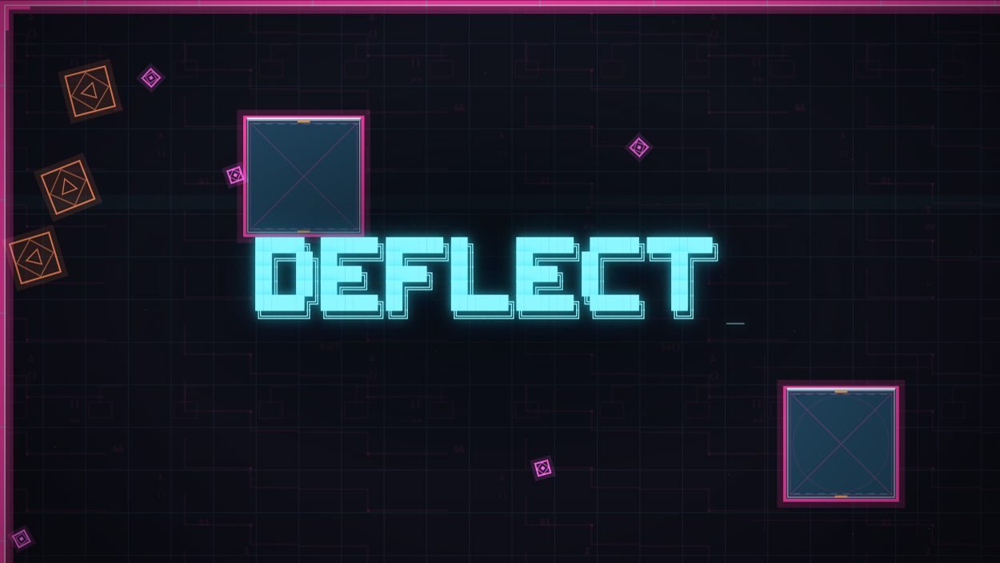

# DEFLECT

A browser-native, top-down geometric arena duelist. One stick sets both movement and facing; you read a
volley, lash or guard it back, and turn the rally on whoever fired first. Everything is drawn from vector
paths and text glyphs and every sound is synthesized at runtime: no sprites, no SVG assets, no audio
files, no game engine.

**Play the alpha:** <https://spuds0588.github.io/DEFLECT/>
**Kiosk demo:** <https://spuds0588.github.io/DEFLECT/?demo=true>
**How to play:** [GAME_GUIDE.md](GAME_GUIDE.md)

[](https://spuds0588.github.io/DEFLECT/?demo=true)

Solo training, endless bot practice, round matches against local bots, a one-life scored gauntlet, a
timed infection clear, the first campaign node, and host/join rooms for up to eight players. VS BOTS and
online versus can run a 1, 3 or 5 game series with random map rotation by default or a fixed custom arena.
SATELLITE's solar wings, meteors, capacitor pods and reentry front are host-synced in those rooms.
ROCKET NAVIGATION, WEAPON SYSTEMS, SPEAK & FIND, CAR NAVIGATION, PONG, AIRPORT, SPACE INVADERS, FAX
MACHINE, SMART PLUG, SMOKE DETECTOR, SMART WATCH, BUSINESS LAPTOP, SPREADSHEET and CHAT are local display
arenas: their launch walls, cockpit consoles, toy cards, car routes, rally balls, flip boards, simulated
cannons, moving print heads, live circuit rings, alarm sirens, sweeping watch hands, scrolling mail,
breakable sheet cells and rising chat bubbles are not synced online.
Thirteen programs, thirty-two arenas. Result and leave overlays offer opt-in `SHARE FEEDBACK`: a local
session JSON with setup, player action totals, round results, deflect sources and FPS/sim samples, shared
through the platform sheet or downloaded with a copied summary. Callsigns, room codes, IPs and raw inputs
are omitted, and nothing is uploaded automatically. The alpha is deployed from `main` on every push.

## Tech stack

| Layer | Choice |
| --- | --- |
| Language | TypeScript, strict, ES2020 output |
| Rendering | Canvas 2D, one canvas, no WebGL |
| Audio | Web Audio synthesis; an 82 BPM lofi-house match loop and a 62 BPM menu bed built from MIDI notes |
| Menus | DOM/HTML over the arena canvas |
| Build | Vite, static `dist/`, no SSR and no server runtime |
| Multiplayer | PeerJS over WebRTC data channels, host-authoritative |
| Delivery | PWA: manifest, generated icons, service worker |
| Dependencies | `peerjs` at runtime; TypeScript, Vite and `tsx` in development |

No game engine (Phaser, PixiJS, Godot) is used. The simulation, renderer and netcode are small enough to
own directly, and the project avoids an engine's asset pipeline and scene model. The full reasoning is in
[AGENTS.md](AGENTS.md) §2; the practical version is below.

## What "no game engine" actually means

### The browser is the platform, not the engine

DEFLECT calls the browser directly: `requestAnimationFrame`, Canvas 2D, Web Audio, DOM and WebRTC. There
is no Phaser, PixiJS, Unity or Godot runtime in the bundle, and no scene graph, prefab system, physics
middleware or asset pipeline behind the game.

That is not the same as having no engine code. We wrote the parts an engine would otherwise provide:

| The browser provides | DEFLECT owns |
| --- | --- |
| `requestAnimationFrame`, Canvas 2D, Web Audio, DOM, WebRTC/PeerJS | the fixed-step loop and accumulator, `World` simulation, collision and knockback, kits and cooldowns, bots and pathfinding, camera framing, renderer, particles, HUD and netcode |

`World` is the simulation. It owns players, projectiles, rounds, pickups and local threats, and `step()`
advances them at a fixed 1/60 s. The renderer never mutates that state; it reads it and draws. Enemies are
hand-written state machines in `World` — worms patrol and bite, viruses roam and charge, sentries hold a
landing zone and fire, cascading errors grow, firewalls sweep — not engine behaviours or prefabs. Bots
read the same public state and write ordinary `InputFrame`s, so they are bound by the same facing locks,
energy, dash charges and cooldowns as a person.

The result behaves like a small purpose-built engine, but it is not general or reusable. It has the
systems this game needs and nothing else, which is where the weight saving actually comes from: no editor,
no scene serialization, no material or shader system, no third-party runtime.

### One canvas, immediate mode

`src/main.ts` owns the only frame loop. `requestAnimationFrame` collects a delta, clamps it to 100 ms,
feeds an accumulator, and runs at most four fixed 60 Hz `World.step()` calls. `Renderer.render()` runs
once with the leftover fraction as interpolation. Physics therefore runs at 60 Hz whether the display is
30, 60 or 144 Hz, and a slow frame sheds time instead of snowballing.

The game is one `<canvas>` using the 2D context; menus are DOM on top. The backing store is a virtual
1280×720 world, letterboxed to the window, with device pixel ratio capped at 2. Each frame clears, then
for each local view sets a camera transform and clips to that pane before drawing in a fixed order: arena
and floor, cover and traversal fixtures, trails, projectiles, threats, pickups, players, marks and
particles, then the screen-space HUD. There is no WebGL, render graph, texture atlas or sprite batch.

### Characters are procedural geometry, not sprites or SVG

No character is a bitmap, sprite sheet, SVG DOM node or pre-rendered image. Every body is rebuilt from
Canvas path commands and text each frame.

- The health hull comes from `pathProgramHealth` in `identity.ts`, and each program owns its geometry:
  Probe a ring with a compass, Wedge a diamond with corner brackets and a thin frame rim, Fisher a hex
  reel, Sweep an octagon, Toxic a twelve-edge star, Kaboom three outward fins, Bad Lag six clock faces,
  Atomize three ellipse orbits, Ghost three outward arcs, Compress six Z marks, Pinball three flipper bats
  on a ring, Copy Pasta three file icons, Aim Bot three scope brackets with inward ticks.
- A player hull is stroked three times: a wide faint glow pass, a mid pass and a bright core pass. Glow
  uses `globalCompositeOperation = 'lighter'`. `shadowBlur`, CSS filters and per-frame gradients are
  deliberately avoided because they cost far more than an extra stroke.
- In local play, health is the hull. A damaged body keeps its lost segments as low-alpha ghosts, so the
  silhouette stays whole and the bright segments are the readout. The centre disc and core mark shrink
  with health, and the local avatar gets a low-health flicker.
- The centre mark is either a vector function (`drawCompassMark`, `drawBombMark`, `drawHourglassMark`,
  `drawAtomMark`, `drawGhostEye`, `drawCompressMark`, `drawPinballMark`, `drawCopyMark`,
  `drawAimBotMark`) or a font glyph drawn with `fillText` through a monospace/symbol stack. Kaboom uses
  Wingdings when that family really exists and falls back to a drawn bomb. Text advances, line splits and
  font strings are measured once and cached, never per frame.
- Animation is state-driven, not frame-driven. The hull turns with `t * 0.22` and spins up during the
  level intro; the core pulses on a sine of time; a hit flashes the hull white; a dash draws a rotated
  triangle afterimage; melee draws the lash, bowie arc or Pinball's two-flipper snap from the current swing
  phase; Sweep's broom is
  cached character rows stretched across the lane; projectiles keep ring-buffer trails; particles are
  pooled. Screen impact feedback is local and edge-only: a hit on the player tints a thin red frame, and
  low health pulses an edge band, never a full-screen additive wash. There are no sprite frames, skeletal
  rigs or tween library. Every effect is a function of
  simulation state and time.

That is also why there is nothing to import: no PNG, WebP or SVG character assets, no atlas and no audio
files. The only generated files are the PWA icons and manifest.

### What that costs, and what it saves

The cost is per-frame path generation, fill and stroke work, and state changes between draw passes. There
is no texture upload or asset decode, but there is also no GPU batching layer: Canvas 2D issues the
strokes itself. The design keeps that bounded:

- Bodies are few — at most eight players plus local threats — and each hull is tens of path commands, not
  thousands. The extra glow passes, not the geometry, are the main draw cost.
- Text metrics, font strings, broom rows and gradients are cached. Gradients are built on resize only.
- The simulation is allocation-disciplined (preallocated pools, ring buffers, A* scratch) and measures
  about **0.035 ms** per tick for a 2P duel and **0.465 ms** for the full gauntlet load on the development
  machine. The detailed table is under [Performance](#performance-on-low-powered-hardware).
- The device pixel ratio cap stops a high-DPI phone paying for 3× pixels it cannot resolve.
- The production payload is about **677 KB of JS (187 KB gzipped) plus 49 KB of CSS (11 KB gzipped)**,
  including PeerJS. There is no engine runtime to download or boot.

The trade is ownership. Collision, camera, netcode, particles and every threat behaviour are ours to
maintain, and there is no editor, tilemap, skeletal animation or built-in profiler. That is a good trade
for a game made of a few dozen vector bodies. It would stop being one if DEFLECT needed large tilemaps,
complex skeletal animation or a level editor — the revisit trigger recorded in AGENTS.md §2.

Rendering targets 144 FPS on integrated graphics, but unlike the simulation there is no automated render
benchmark. The browser stress path (`?stress=N` with the F3 performance HUD) is how it is measured; the
headless simulation benchmark is `npm run bench`.

## Architecture

### One loop, two clocks

`src/main.ts` owns the frame. Each `requestAnimationFrame`:

1. Clamps the frame delta to 100 ms.
2. Adds it to a fixed-step accumulator and runs up to four 1/60 s `World.step` ticks.
3. Renders with the leftover accumulator as an interpolation fraction.

So physics is always 60 Hz regardless of the display rate. A 144 Hz monitor renders smoother motion, a
30 Hz device drops frames without changing the simulation, and a slow frame cannot trigger a spiral of
death: the four-step clamp sheds time instead of falling further behind.

### Simulation is the only truth

`World` owns players, projectiles, rounds, bots' inputs, pickups and local threats. The renderer never
mutates it; it reads state and draws. Every entity is preallocated and reused through `active` flags, and
`step()` and `draw()` avoid per-frame allocation: no object literals, arrays, closures or string building
in the hot path. Particles and projectile trails are pooled ring buffers.

Content is data, not branches:

- `src/game/arenas.ts` holds pillars, spawn rings, traversal plates, tutorial rooms (including the holding cell block), open decks, breakable props, pipe fixtures, moving keypad caps, USB drive geometry, satellite floor/solar/telescope/meteor/reentry data (host-synced online), rocket launch/telemetry data, weapon-console data, wall style and floor signature.
- `src/game/sessionReport.ts` owns the opt-in session tracker and share text; `World` and `Snapshot` do not carry its state.
- `src/game/programs.ts` holds the roster identity and kit tuning; the four action jobs branch in `World`.
- `src/game/tuning/*.json` holds all gameplay numbers, re-exported through the typed facade in
  `src/game/config.ts`, so most balance changes are a JSON edit with no code change.

Local bots are not part of the simulation. `BotBrain` reads public state and writes the same `InputFrame`
a human writes, then `World.step` treats it identically. That keeps bots bound by facing locks, dash
charges, energy and cooldowns, and it keeps AI cost out of the physics loop.

### Code map

| Area | Files |
| --- | --- |
| Frame loop, input routing, sessions, UI wiring | `src/main.ts` |
| Fixed-step simulation, rounds, kits, threats | `src/game/world.ts`, `entities.ts`, `movement.ts`, `collision.ts` |
| Renderer, camera framing and split view | `src/game/render.ts`, `camera.ts` |
| Program identity and vector marks | `src/game/identity.ts`, `programs.ts` |
| Bots and pathfinding | `src/game/bot.ts`, `nav.ts` |
| Local content | `powerups.ts`, `campaign.ts`, `saves.ts`, `gauntletRecords.ts`, `infectionRecords.ts` |
| Ordinary program monitors | `regulars.ts` |
| Networking | `src/net/net.ts` |
| DOM and touch controls | `src/ui/dom.ts`, `src/ui/touch.ts` |
| Tuning | `src/game/tuning/*.json` |
| Build tooling | `scripts/bench.ts`, `scripts/gen-icons.mjs` |

### Gauntlet ingress: one edge, one burst

Automatic gauntlet arrivals are queued into a transient red portal on an arena edge. The portal opens,
releases its whole group across the mouth on one simulation frame, holds for `GAUNTLET.assault.burstHold`,
then closes. If no edge point is both clear of cover and far enough from the player, the queue waits rather
than dropping a body nearby. Sentry packs arrive as pairs when the live cap has room, worm and virus groups
arrive together, and a cascading-error colony enters as a three-block burst. Campaign opening squads and
authored campaign ports are separate content.

### Campaign levels: one device, one portal

A campaign level is one arena in an ordered route, not a floor plan joined to the next. Clearing a node
saves the slot, script_kitty opens a portal, and the party is dropped on the next device. There is no
bridge between islands and no `NEXT ARENA` menu between devices; only the last node parks on a result
overlay. `QUARANTINE` is four portal-fed arenas: INTAKE, HOLDING, MAINBOARD and ROUTER. Each is one room
with its own furniture and labels; the only way between them is the portal. All four use the full
`48,48 -> 1942,1046` playfield: the quarantine rooms were too cramped to dodge fire or make a reflect read.
INTAKE is deliberately bare, with three dormant lock targets (one circle, one triangle and one rectangle)
and no cover. They are not placed until the Warden's lesson reaches target lock, so the player meets three
subjects instead of a full class. The lesson ends by waking them: he gets one shocked line and drops out of
the story box, the system orders `DESTROY ALL AWAKENED PRIMITIVES`, and the first portal opens only after
all three are gone. The triangle fires a fast three-round fan rather than a shard cloud, on a longer
cadence; the rounds are ordinary hostile shots, so guard and lash return them. The class absorbs hits
during the lesson and while any subject is still opening; otherwise the lesson's own fire step wakes them
and a held burst can delete the fight before the shock beat. HOLDING's ten-cell row spans the full north
wall and is only 170 units deep, so the held threats are easy to read; the open floor is in front, and the
cells remain a local barrier, not an island gate. Its six-subject class is already awake when the party
lands, chasing the civilian staff; Kitty's arrival line runs over the start, then the skill briefing.
Clearing that class powers the block down and releases two worms and eight viruses, already walking toward
open-floor waypoints instead of waiting behind the bars to be picked off. A clear holds the room for
`CAMPAIGN.clearDelay` (2.0 s) after the last port or hostile dies, so death animations finish before the
right-wall portal opens. The exit camera pulls back to `CAMERA.portalArenaZoom` for `CAMPAIGN.portalLead`
before the mouth opens, so the party can be watched crossing the room into it. An arrival holds the body at the left mouth for
`CAMPAIGN.campaignEntryThrowDelay` (2.15 s) while the hop wipe opens, then applies the decaying
`portalThrowSpeed` (1500) throw and 1.4 s of entry protection. Landing lanes stay clear of authored
hostiles. Three local save slots back the run: a filled row can be cleared after confirmation, and `START
NEW GAME` takes the first empty slot or, when all three are full, asks which save to replace before the
bot setup starts.

Threats still arrive through authored **ports** (`ArenaDef.ingress`): fixed, fully opaque red damageable
squares that emit a threat family on a clock and stop when shot shut. Ports reuse the file-box damage path
rather than a second entity type, respect the same live caps as a sentry pack, and gate the exit directly:
the right-wall portal pull opens only when every port is shut **and** every live hostile from that room is
gone. A shut port bursts into a spray of red squares, matching the enemy death language. Ports are
local content — campaign and infection only, never in a snapshot. REBOOT is fed by six corner ports; the
Mega Worm is announced only after all six and their delivered bodies are cleared. REBOOT opens with its
authored squad already on the floor (four sentries, two viruses and a worm), so the arena is never an empty
wait. During a pass the Worm fires jagged red balls to both sides; guard or lash one back into its body to
damage it. The heavy beam stops at the Worm instead of drawing through it, and every hit sparks at the
contact point. Its death spends one final scream and a large red-square burst. A final-node clear plays
Kitty's trail beat, pulls the party through the portal, then parks on the level result with
`MORE LEVELS COMING SOON`. GRID ZERO's outer edge is open to shots and beams (but not bodies), so the Worm
can be hit on its staged approach before it crosses the lip.

Every round-based match hops the same way. When a round ends, a white portal opens on the right wall and
pulls every standing body in; the next round is thrown out of the left-wall mouth with a decaying eastward
impulse, not placed under it. The pull writes positions directly, so cover cannot trap a body. Campaign
entries keep the landing lane clear of authored hostiles and add a short entry protection window. Local and
bot modes rebuild the `World` on the next arena, carrying scores and
the round number; the host broadcasts `MSG.HOP` so guests rebuild their `NetView` on the same arena. The
renderer's square portal wipe covers the swap. Open decks inside a plate arena are floor, never a
progression gate.

## Performance on low-powered hardware

The design targets are a **4 ms average 60 Hz sim tick** with 8 players and 48 live projectiles, and
**144 FPS rendering** on integrated graphics. Both are guardrails, not hopes: the sim has a headless
benchmark and the renderer follows hard rules.

### Measured simulation cost

`npm run bench`, 1800 ticks after 400 warmup, on this development machine (milliseconds per 60 Hz tick):

| Scenario | avg | p99 | max | Live projectiles / threats |
| --- | --- | --- | --- | --- |
| 2P duel | 0.035 | 0.157 | 2.890 | 0.6 |
| 4P brawl | 0.050 | 0.167 | 1.002 | 1.6 |
| 8P stress | 0.071 | 0.188 | 0.770 | 7.0 |
| 8P max projectiles | 0.110 | 0.276 | 1.269 | 25.8 |
| 8P bot swarm (AI + sim) | 0.162 | 0.700 | 4.825 | 5.9 |
| Gauntlet max (all threat families) | 0.465 | 1.355 | 8.529 | 28.6 |

Average and p99 leave most of the 16.7 ms frame budget on the table. The occasional high `max` is a
scheduler or garbage-collection outlier, not steady cost; the guardrail is the average.

### Why it stays fast

- **No assets to load.** Art is paths and text glyphs drawn each frame. Audio is oscillators, noise and
  filters. The only generated files are PWA icons. The production payload is about 198 KB gzipped
  (677 KB JS and 49 KB CSS before compression), including PeerJS.
- **Allocation discipline.** Preallocated entity pools, a pooled particle system, cached label strings,
  preallocated A* scratch. The hot path is written to avoid triggering collections rather than to survive
  them.
- **Cheap glow.** Glow is a multi-pass stroke with `globalCompositeOperation = 'lighter'`. `shadowBlur`,
  `filter` and per-frame gradients are banned; gradients are built on resize only.
- **Bounded device pixels.** The backing store is capped at 2× device pixel ratio and letterboxed to 16:9,
  so a high-DPI phone does not pay for 3× or 4× pixels it cannot resolve.
- **Cheap AI.** Bots replan on a timer with a preallocated per-arena navigation grid and line-of-sight
  shortcuts, never a full-grid search per tick.
- **Local modes pay no network cost.** Training, bot matches, the gauntlet, the campaign and solo
  infection never serialize or send a packet; online co-op is opt-in.
- **Defensive catch-up.** The four-step clamp, a 100 ms delta cap and render interpolation keep a stalled
  tab from snowballing.

A phone that cannot hold 60 FPS still sees a correct simulation at the rate it can render, because
rendering and physics are decoupled.

## Multiplayer with PeerJS

There is no game server. One player hosts, everyone else connects to that browser, and the host is the
authority:

```
              host (slot 0)
              authoritative sim @ 60 Hz
             /      |       \
       guest 1   guest 2   guest N      each sends inputs, receives snapshots
```

- **Room code, not an account.** A 4-character code from an unambiguous base-32 alphabet maps to the peer
  id `defl-arena-v1-<CODE>` on the PeerJS public cloud broker. The broker only performs WebRTC signaling;
  gameplay traffic flows peer-to-peer over data channels.
- **Inputs up, snapshots down.** Guests send their `InputFrame` at 60 Hz. The host runs all physics, hit
  detection, scoring and round flow, then broadcasts a 30 Hz snapshot as nested numeric arrays serialized
  with BinaryPack. No JSON on the wire.
- **Two room modes.** The host's lobby toggle selects `VERSUS` or `INFECTION`. Infection runs the gauntlet
  colony on the host; its snapshot also carries the shared clear meter and compact virus rows, so guests
  render the swarm without simulating it. Dead operators spectate until the last runner falls.
- **Local feel.** A guest predicts only its own movement against the shared arena, and interpolates every
  other body from a 65 ms snapshot buffer. The host never predicts; it owns the result.
- **Bandwidth.** A full 8-player, 48-projectile snapshot measures **2.45 KB** packed (one event included),
  or **73.4 KiB/s per guest** at 30 Hz. Two-way traffic for a typical guest stays well under 100 KiB/s;
  with seven guests the host uploads about **0.50 MiB/s**. That is why the v1 cap is 8 players: it is the
  host's upload that runs out first, not the protocol. A hazard arena adds about **16 B** on a clock-only
  map and up to **192 B** on SATELLITE with seven live meteors (v0.1.112), about 5.8 KB/s per guest at
  30 Hz.
- **Live status.** The lobby shows a measured `RTT`; an online game adds a compact `MP STATUS` panel with
  the role, room code, connected operators, smoothed round-trip time and measured snapshot cadence. The
  host averages its guests and a guest measures the host. These are local UI metrics: they never enter
  `LobbyState` or `Snapshot`, and a peer that does not answer the ping protocol simply shows `--`.
- **Failure behavior.** If the host closes the tab the room ends; guests get a disconnect state. A guest
  leaving frees its slot. There is no migration and no dedicated server.
- **What is not networked yet.** Versus rooms carry match state, infection co-op adds its clear readout
  and virus colony, and hazard arenas add their fixture clocks. No programs, kits, pickups, campaign
  state, most gauntlet threats or pipe/firewall fixtures cross the wire. Online opponents currently use
  slot identity and Probe's kit. Server hosting and richer snapshots are separate future work.

The same 4-character room join path is the intended cross-platform layer for native builds (see the
roadmap): a Tauri app and a browser both speak WebRTC.

## PWA

DEFLECT ships as an installable progressive web app:

- `manifest.webmanifest` requests standalone, landscape, dark chrome. Installed, it launches without
  browser UI, which matters for a kiosk or a handheld.
- A service worker precaches the shell and caches hashed build assets on first fetch. Navigation is
  network-first, so a deploy lands on the next reload without a version bump; the cached shell is the
  fallback, and solo modes still open offline after the first visit.
- Distribution is a URL, not a store: no install gate before the first match, no review cycle for a
  balance patch, and one build for desktop and mobile browsers.
- The installed shell and the kiosk demo URL make it practical to leave a station running unattended.

The PWA also has a real cost: installability and caching differ per browser, and iOS still has its own
quirks. The app is a normal web page first and an installable app second.

## Input

Keyboard/mouse, gamepad and touch all write the same `InputFrame`.

- **Gamepad** uses the standard mapping, with an analog left stick and a 0.2 deadzone. Controller rumble
  uses the Gamepad API's `vibrationActuator` where available, with the older `hapticActuators.pulse`
  fallback; pads without either are simply silent.
- **Keyboard** is 8-way; `Q` toggles target lock. The mouse is buttons only and never sets facing.
  Gamepad `LT` remains hold-to-lock.
- **Touch** puts a stick at the bottom left and shield, skill and dash buttons at the bottom right. Auto
  lock and auto attack are on by default for touch and can be turned off.
- **Local couch play** (`MULTIPLAYER > LOCAL`): P1 is keyboard + mouse; every detected gamepad is adopted
  as P2–P4. Plugging in a pad joins on the setup screen or mid-match, up to four players.
- The most recently used device owns input; there is no on-screen input-mode switch. On a gamepad,
  `View`/`Select` toggles the canvas UI and `Start` opens the in-game menu.

Control tables and the full touch layout are in [GAME_GUIDE.md](GAME_GUIDE.md#controls).

## Roadmap

- **Tauri desktop builds (Windows, macOS, Linux).** Wrap the same static build in a Tauri shell to ship
  signed executables with native window management, offline caching and no browser chrome. The web build
  stays the source of truth; Tauri is a delivery shell, not a port.
- **Android APK through Tauri.** Tauri's mobile target can package the same web runtime into an APK while
  keeping touch controls. That makes a native Android build possible without a second engine or a second
  renderer.
- **Cross-platform play.** Browser and native clients would join the same 4-character rooms over PeerJS,
  because the network layer is browser WebRTC. The native build adds packaging, not a parallel netcode.
- **Public room discovery.** Planned around a shared prefix on the room code, with private rooms keeping
  an unprefixed code.
- **More campaign nodes and sectors.** `BUILD ROOT` and `REBOOT` are live; the rest of the sector graph
  and layout handoff live in [CAMPAIGN.md](CAMPAIGN.md).

None of the Tauri work is built yet. It is listed because the current stack was chosen to make it a
packaging step rather than a rewrite.

## Development

```bash
npm install
npm run dev       # http://127.0.0.1:5173
npm run build     # strict typecheck + production PWA build into dist/
npm run preview   # serve the production build locally
npm run bench     # headless 60 Hz sim benchmark
npm run icons     # regenerate PWA icons
```

The alpha is deployed to GitHub Pages by `.github/workflows/pages.yml` on every push to `main`
(`npm ci`, `npm run build`, Pages artifact upload). The repository's Pages source must be **GitHub
Actions**, not the raw branch. Serve `dist/` over HTTPS locally if you need to exercise the service
worker, install flow or offline shell.

- Gameplay numbers: [src/game/tuning](src/game/tuning), typed in `src/game/config.ts`.
- QA boot hooks (`?playtest=1` arena tour and log export, `?autoplay=N`, `?gauntlet=1&arena=N&bot=1`) and
  the player-feedback pipeline decision: [PLAYTEST.md](PLAYTEST.md). Normal-play `SHARE FEEDBACK` is
  documented there and in `src/game/sessionReport.ts`.
- Architecture, invariants, protocol and performance guardrails: [AGENTS.md](AGENTS.md).
- Forward plan and open questions: [TODO.md](TODO.md).
- Session log and measurements: [HISTORY.md](HISTORY.md).
- Gameplay reference and QA checklist: [GAME_GUIDE.md](GAME_GUIDE.md).
- Original design spec: [PRD-Deflect_game.md](PRD-Deflect_game.md).

## License

DEFLECT is **source-available**, not OSI open source. You can read, run, study, and modify it for
non-commercial use. Selling it or building a paid product on it requires prior written permission.
Modders are explicitly welcome to build and share free mods, provided they credit Corey Burns, link back
to this repository, include the license, and do not present their work as official. See [LICENSE](LICENSE)
for the full terms.

## Mini-bosses

`src/game/minibosses.ts` registers two bosses. `MEGA WORM` is a segmented chain with per-plate health;
`IDLE HANDS` is three floating palms with Unicode eyes that slam and charge, and can be dashed into each
other. Both arrive through the gauntlet ingress and live in the worm body pool.

## Memory fragments

`src/game/memory.ts` holds the PvE comeback rule: a downed player leaves a shard that grants +1 health
segment, +20% walking speed and +25% damage for the rest of the run, stacking to three. It drops in every
mode except the versus match, once per body per run, and campaign carries the stacks between nodes.

`STARFISH` is the third mini-boss: one center and five separate arm bodies. Arms detach when stripped and
hatch a new Starfish if not destroyed, and the center's mouth opens once an arm is gone. It shares the worm
body pool and the same registry as the others.

`FILE BLOB` is the fourth mini-boss: 96 file icons as health, drawn in three reused depth layers over a
ten-node spring rim, so the pile looks like hundreds of files while simulating none. Its lobbed glob glues
a player into a file cage that has to be shot or swung off.

`STORM CLOUD` is the fifth mini-boss: one boss-scale body that holds the ceiling band, rains alternating
rows of shootable drops, and throws a telegraphed bolt whose reflection is the fight's biggest punish. Bots
step out of its rain lane through the same hazard-steering layer that handles emitter corridors.

Mini-bosses are allowed to overhang the arena edge by up to half their radius (`bossEdgePad`), so a boss
silhouette is never squeezed to fit the playfield. Ordinary worms, players and projectiles keep
full-radius clamping.


## Test range

`TEST RANGE` is a QA-only sandbox arena (3480x1920, empty floor) hidden from the arena picker. Boot it with
`?range=1`, optionally `&bot=1&mega=1`, to read boss scale and behaviour before geometry gets a vote.

The Mega Worm now arrives at roughly three times its old silhouette, doubled health and a straight-line flight
model. Campaign REBOOT gives it a slow harmless entrance pass and four fixed fly-by lanes with a wide arena
camera; it never homes on the player after the entrance, and no small families spawn between passes. The
reposition between lanes is a short beat, not a stall. Each pass fires a pair of jagged red balls to the
Worm's sides; they are ordinary reflectable shots, and a returned one damages the boss on contact. Its body is
one rigid chain with a capsule hit test, so a shot that lands between two plates still connects, and the
heavy beam ends at the near edge of the body. Hits spark at the actual contact point. The minimap draws the
whole segmented chain at its real footprint, not a single dot.


## Demo boss rotation

The attract loop and `?demo=1` alternate ordinary seeded wave runs with boss showcases. Each showcase
cycles one of the five mini-bosses, seeded on a shallow wave so the boss is the subject, and spawns it
across the room from the squad. The next session returns to a normal run.
